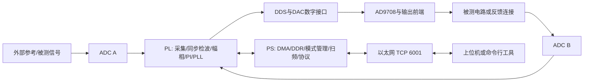

# 系统架构与职责

不同演示模式的接线不同，不把 PLL 的外部参考接线与电路扫频的 A/B 接线混为一谈：

- 幅值稳幅：ADC B 测量目标反馈节点，PL 根据目标与测量值更新数字幅值。
- 电路扫频：A 测 DUT 输入，B 测 DUT 输出，先取得双通道直通基线，再运行一次自动粗扫和局部精扫。
- PLL：A 接独立外部参考，DAC 输出接 B 做验证；B 不在当前 PLL 反馈路径内。
- 偏置：PS 将目标电压通过 DAC 标度换算为数字偏置；此路径为开环。

PL/PS 配套标识包括 DDS3、SWM1、DPL1。旧 XSA、旧位流和新 ELF 混用会导致接口不一致，AXI 地址不通时读取 ID 本身也可能挂起；ID 校验不能替代地址映射、时钟和复位检查。

完整图形上位机还承担 FFT、自动测量显示及 AI 辅助分析；这些上位机源码尚未加入本快照。
